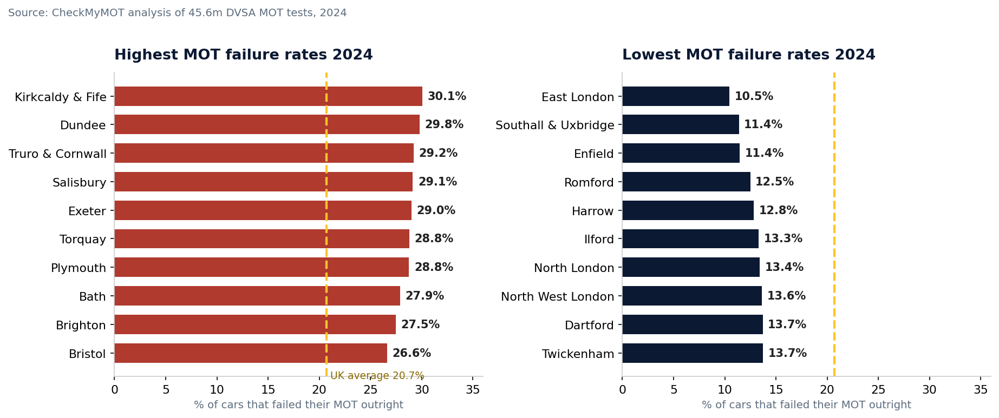
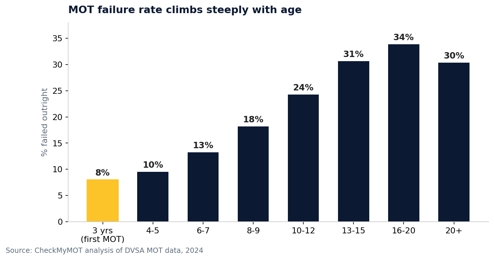
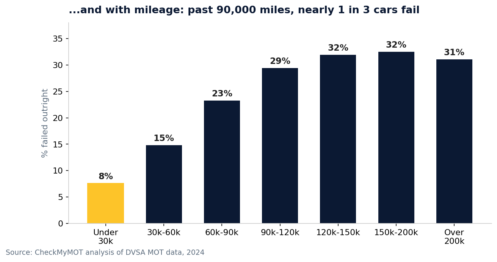

# UK MOT Failure Rates by Area — 2024

Every area of Great Britain ranked by MOT failure rate, computed from
**45,573,249** anonymised MOT test records published by the DVSA
(Driver and Vehicle Standards Agency) for 2024.

**Read the story:** https://checkmymot.com/mot-failure-rates-by-town/
**By:** [CheckMyMOT](https://checkmymot.com/) — free UK MOT checks for drivers.

## Headline findings

- **20.7%** of cars failed their MOT outright in 2024; **25.9%** arrived
  with a failure-level defect (including passes after rectification at the station).
- Worst area: **Kirkcaldy & Fife (KY)** — 30.1% outright fail rate (273,722 tests).
- Best area: **East London (E)** — 10.5% outright fail rate.
- Regional split: South West 26.4% fail vs London 13.7%.
- By fuel: hybrid 8.7%, electric 10.9%, petrol 20.6%, diesel 22.4% fail.
- By age: 8.0% fail at first test (3 yrs) → 33.9% at 16–20 yrs.





## Data

| File | Contents |
|---|---|
| `data/mot_failure_rates_by_area_2024.csv` | 116 postcode areas: tests, outright fails, passes-after-rectification, both fail rates |
| `data/national_summary.json` | National totals + top/bottom areas |
| `scripts/crunch_areas.py` | The aggregation script (pandas, chunked) |
| `charts/` | The three charts from the article |
| `METHODOLOGY.md` | Exactly how the numbers were computed |

### CSV columns

- `postcode_area` — UK postcode area code (e.g. KY)
- `town` — main town/area name
- `tests` — class-4 normal tests in 2024
- `fails_outright` — result `F`
- `passes_after_rectification` — result `PRS` (failed, then passed after repair at the station)
- `fail_rate_pct` — outright fails ÷ tests × 100
- `initial_fail_rate_pct` — (fails + PRS) ÷ tests × 100

## Reproduce it

The raw microdata is DVSA open data (too large for GitHub at ~1.5GB zipped):
`https://edh-dvsa-data-gov-uk-files-prod.s3.eu-west-1.amazonaws.com/`
(monthly `test_result_YYYY-MM.csv` files). Download 2024, then:

```bash
pip install pandas
python scripts/crunch_areas.py
```

See `METHODOLOGY.md` for filters and definitions.

## Use of this data

The underlying test records are © DVSA, published under the
[Open Government Licence v3.0](https://www.nationalarchives.gov.uk/doc/open-government-licence/version/3/).
Our aggregation and charts: MIT — use freely with attribution to CheckMyMOT.
